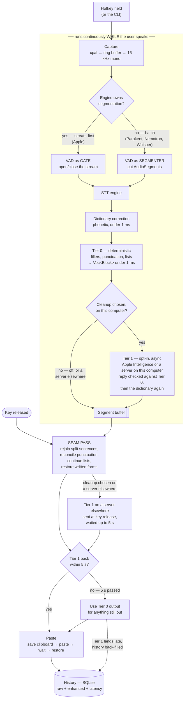

# Architecture

## The user's view

`voice-dictation.png` is the honest user-facing story: press a key, speak, text
appears, it's saved. That is what someone experiences, and it is the right
altitude for the landing page.

It is not the architecture. Two things it leaves out change everything.

**There is no transcription step in it.** Audio does not become text on its own.

**It is drawn sequentially, and the whole design is concurrent.** The user view
implies: finish capturing → then clean → then paste. That is precisely how
a sequential design works, and it is *why* such designs pause for seconds after
key-release. Macalla runs the entire chain **per segment, while the user is
still speaking**. On key-release, only the trailing segment is still in flight.

That single difference is the central design choice, and it is what lets an
853 ms Tier 1 backend finish inside the 5 s the paste waits for it. Draw it
sequentially and every segment waits in line after release; draw it
concurrently and only the last segment is still out when the key comes up.

## The real pipeline

Cloud transcription is not drawn, because it runs outside this loop. The whole
recording goes up in one request when the key is released, on a worker thread,
while an on-device engine shows the live preview; a network request inside the
loop would hold it up for seconds per utterance. A cloud dictation
therefore does not get the per-segment speed this page describes: its text
arrives after release.

Cleanup on a server that is not on this computer stays out of the loop for a
different reason: it must not see words the person might still throw away. It
is sent nothing while they speak. The whole text goes to it at most once, when
it is ready -- at key release, or when cloud transcription answers -- and not
at all once the person has thrown the dictation away. The paste
waits up to 5 s for the answer, and an answer that comes later replaces the
pasted text in History. Cleanup of either kind is off until the person chooses
a provider.

## What the user view omits, and why each matters

| Missing | Why it matters |
|---|---|
| **STT engine** | The actual transcription. Two shapes — stream-first and batch — and which one you have decides what VAD is *for*. |
| **Segmentation** | Segments are the unit everything runs on. Without them there is no per-segment concurrency. |
| **Concurrency** | Drawn sequentially, every segment waits in line for Tier 1 after release. Drawn per-segment, only the trailing segment is still out when the key comes up. |
| **Dictionary correction** | The second central design choice. It runs *before* Tier 0 and Tier 1, so a model never sees a mangled technical term, and again over what Tier 1 sends back, so a reply that respells or re-cases a term is put right. |
| **Two tiers, not one "cleanup"** | The decision node gates **Tier 1 only**. Tier 0 is deterministic, sub-millisecond and always on. Tier 1 is off until the person chooses a provider. |
| **The 5 s wait** | With Enhancement on, the paste waits up to 5 s for Tier 1, and the overlay says so. Missing it is a designed path, not an error. |
| **Seam pass** | Segments are not sentences. Boundaries must be rejoined at assembly, and they fall in different places depending on whether VAD or the engine produced them. |
| **History back-fill** | When Tier 1 lands after paste, history is updated with the better text. The user keeps a paste that waited no more than 5 s, and the good record. |
| **Discard** | The overlay's × or Cancel Dictation in the menu bar throws a dictation away. Nothing is pasted or kept, and nothing is sent to a server elsewhere, even when the discard lands while the engine is finishing. |

## Where each diagram belongs

- **User view (`voice-dictation.png`)** — the landing page and the top of
  the README. Do not add boxes to it; its value is that it fits
  in one glance.
- **This pipeline** — `docs/`, the architecture write-up, and any technical
  post. This is the "out-engineer, don't out-narrate" artefact: it shows the
  concurrency that the competition does not have.
